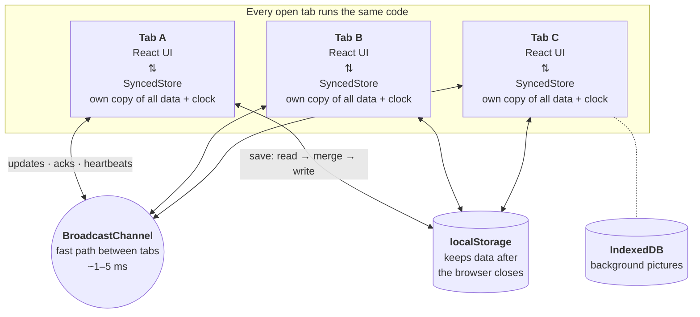
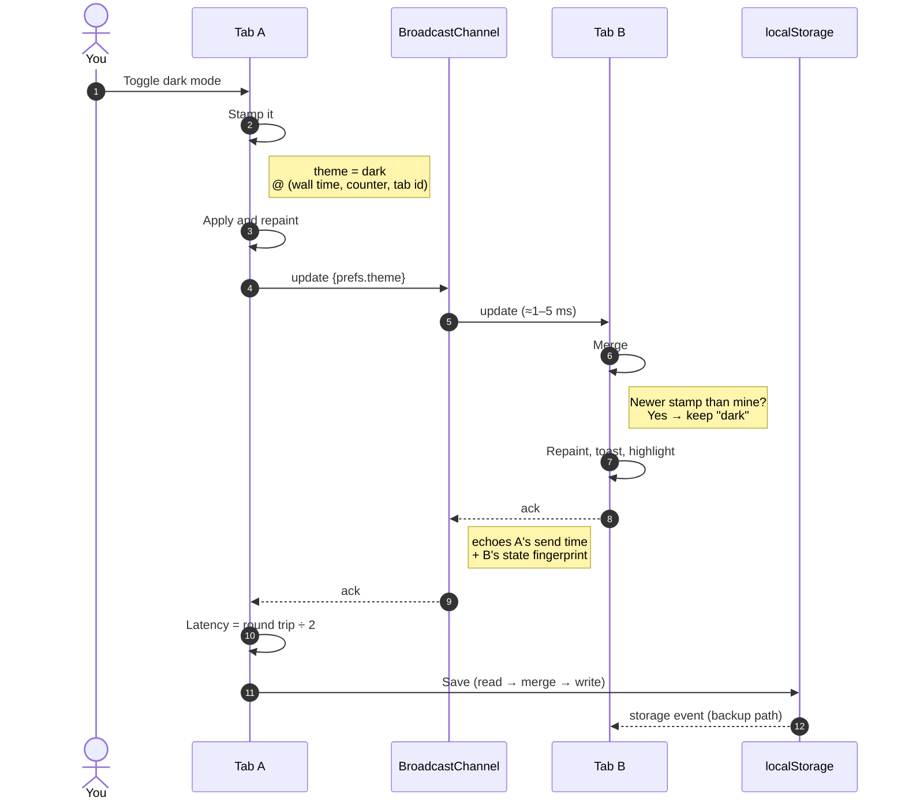
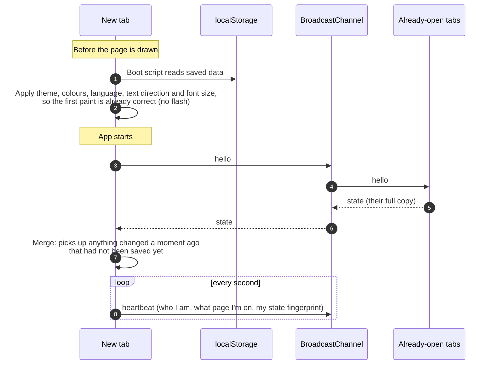
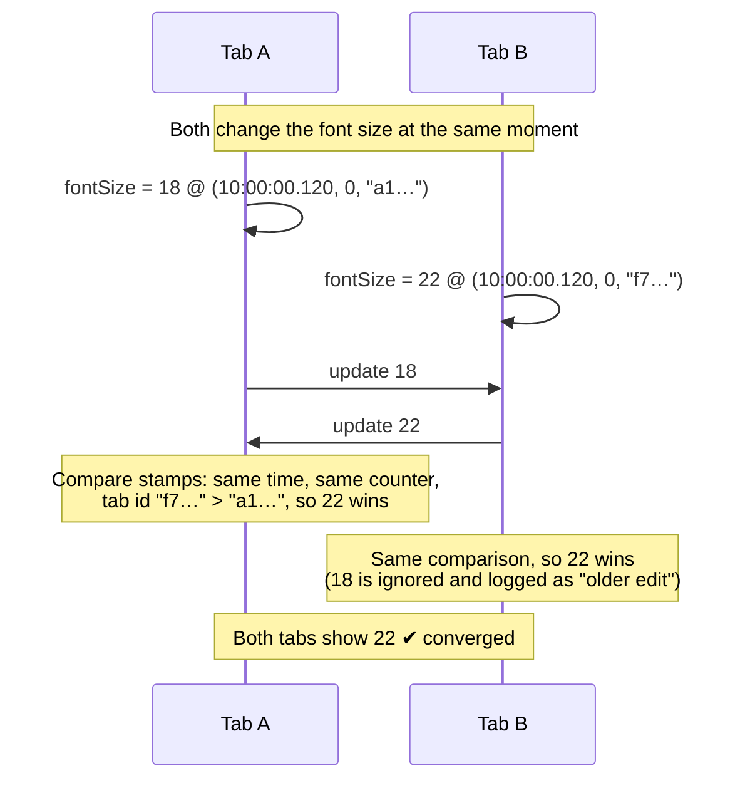
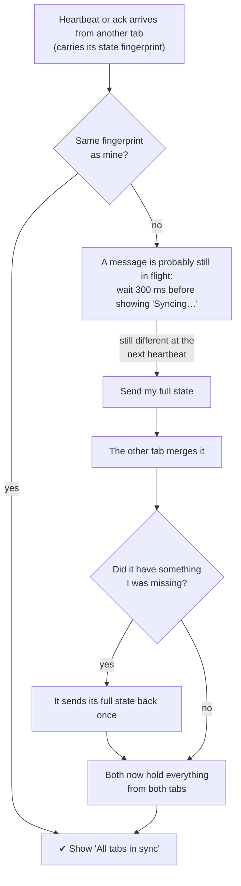
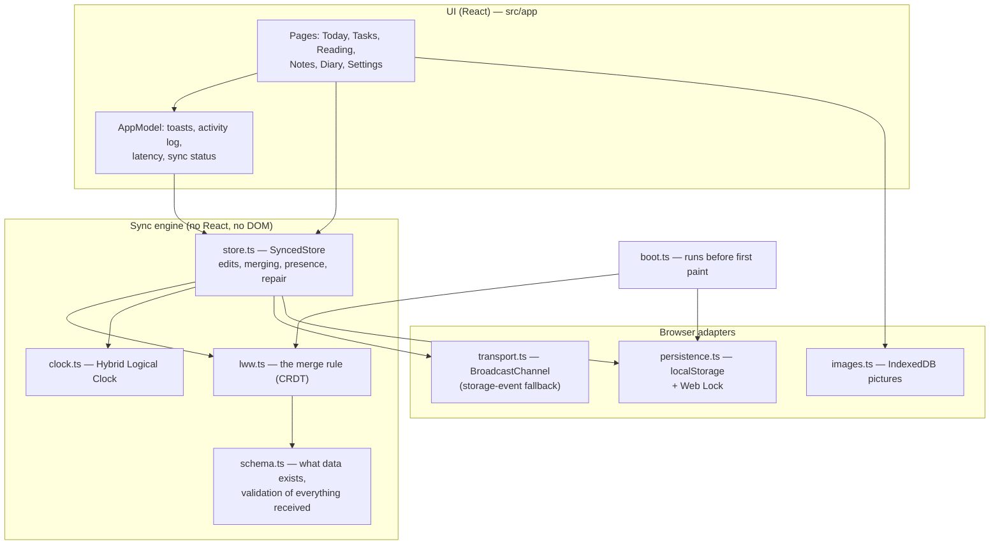

# Daybook

Daybook is a personal workspace that combines **tasks, a reading list, notes and a diary**. You can open any part of it in as many browser tabs as you like: preferences and data stay in sync across every tab in real time, survive closing the browser, and resolve simultaneous edits deterministically.

**Live demo:** https://chiranshee26-source.github.io/tab-sync/ (open it in two or more tabs side by side)

It was built for the *Multi-Tab Settings Synchronization* task. The required preferences (a **dark-mode toggle**, a **language selector** and a **font-size slider**) live under *Settings & sync*; dark mode can also be toggled from the sidebar. The same sync engine also carries all the user's data, which gives the app a real reason to be open in several tabs.

## Task requirements at a glance

| Requirement | How Daybook meets it | Verified by |
| --- | --- | --- |
| **Dark-mode toggle** | Switch in *Settings & sync*, plus a quick toggle in the sidebar | e2e: settings controls |
| **Language selector with multiple languages** | 7 languages (en, es, fr, de, hi, ja, ar) covering every string in the UI; Arabic switches the layout to right-to-left; dates and times are localised with `Intl` | e2e: settings controls (RTL) |
| **Font-size slider** | 12–24 px slider with −/+ buttons; scales all text through a root `font-size` | e2e: settings controls |
| **Real-time sync without refresh, < 100 ms** | `BroadcastChannel` messages carrying only the changed fields; typically 1–5 ms, shown live in the sync panel (see [Synchronization](#synchronization)) | e2e: propagation under 100 ms |
| **Persistence after all tabs close** | `localStorage` with read-merge-write under a Web Lock; pictures in IndexedDB | e2e: persists after closing every tab |
| **New tabs load the latest settings without a flash of the wrong theme** | Inline boot script applies theme, colours, language, direction and font size before first paint; a handshake fetches anything not yet saved | e2e: no wrong-theme paint; picture colours before first paint |
| **Deterministic conflict resolution, all tabs converge** | Last-Writer-Wins map CRDT with Hybrid Logical Clock timestamps; self-repair on fingerprint mismatch (see [Conflict resolution](#conflict-resolution)) | unit: merge laws, randomized delivery orders; e2e: four tabs, concurrent-edit test |

| Submission item | Where |
| --- | --- |
| GitHub repository with the complete source | https://github.com/chiranshee26-source/tab-sync |
| README with installation and execution instructions | [Getting started](#getting-started) |
| Technical explanation of synchronization and conflict resolution | [How multi-tab sync works (illustrated)](#how-multi-tab-sync-works-illustrated) and [Technical explanation](#technical-explanation) |
| Deployment link | https://chiranshee26-source.github.io/tab-sync/ |

## Try it in a minute

1. Open the [live demo](https://chiranshee26-source.github.io/tab-sync/) in two windows side by side. You can also click *Open another tab* in *Settings & sync*.
2. In one window, go to *Settings & sync* and toggle dark mode, switch language or drag the font-size slider. The other window follows instantly; a toast names the tab that made the change, and the *Synchronization* panel shows the latency.
3. Click **Run concurrent-edit test**. Every open tab changes the same settings at the same instant. The activity log shows older edits being discarded, and all tabs end on identical settings (compare *Technical details → State fingerprint*).
4. Add a task or type in today's diary in one window and watch it appear in the other. Open a note in both windows: each shows "Also open in tab …", and edits sync as you type.
5. Under *Background & colours*, choose a photo. Every tab adopts its colours.
6. Close every window and reopen the app. Everything is restored, with no flash of the default theme.

## Design

Daybook is styled as a warm **autumn almanac**:
- **Palette:** paper, espresso, rust, ochre and olive.
- **Type:** Fraunces, a soft serif, for headings and writing; Instrument Sans for the interface. Both are self-hosted.
- **Texture:** a faint paper grain over everything.

The **home page** is the showpiece. Its hero is an illustration of the *actual time of day*:
- The sun (or a crescent moon) travels along an arc, the sky shifts from dawn to golden hour to dusk to night, and leaves drift over layered autumn hills.
- Under it sit today's date in a large serif, the day of the year, and the time of day.

Below the hero are reasons to come back every day:
- a ruled journal page with a mood picker and word count
- your week of moods
- a writing streak
- *On this day* memories ("A week ago today you wrote…")

The other pages use the same palette but stay calm and functional.

### Your picture, your colours

Under *Settings & sync → Background & colours*, pick or drop any photo. It becomes the home-page hero and a soft, blurred backdrop behind every other page, and **the whole interface adopts its colours**, in light and dark mode:

1. **Extract.** The picture is shrunk to 96 px and its pixels are clustered with k-means in **OKLab**, a perceptual colour space. The dominant cluster becomes the *base*; the most vivid cluster that covers a meaningful part of the picture (chroma × √coverage) becomes the *accent* (`src/color.ts`).
2. **Derive.** Light and dark token sets are built in **OKLCH**. They keep the picture's hues but set lightness and chroma deliberately, then nudge lightness until every text/background pair meets WCAG contrast (text ≥ 7:1, muted text and accent ≥ 4.5:1). Status colours stay green, amber and red. Unit tests check this for blue, almost-white, almost-black, garish and autumn pictures.
3. **Store and sync.** The resized picture goes to **IndexedDB**, named by a SHA-256 of its contents. The synced document only holds an `appearance` record with that id and the colour seeds, both stamped with one timestamp so concurrent changes never mix one tab's picture with another's colours. Every tab switches at once.
4. **No flash.** The inline boot script applies the derived colours before first paint, just like the theme.
5. **Your pictures.** Every picture you use is kept in a synced gallery (`picture:<hash>` records, pictures stored in IndexedDB), so you can switch back to an earlier one with a click, from any tab, or remove it.

## What you can do

| Section | Features |
| --- | --- |
| **Today** | Time-of-day hero (or your picture), ruled journal page with mood and word count, week of moods, writing streak, *On this day* memories, open tasks with quick add, what you're reading, recent notes |
| **Tasks** | Add tasks with optional due dates, tick them off, overdue and due-today badges, inline editing, clear completed |
| **Reading list** | Save articles or books (with optional links), move them through *To read → Reading → Finished*, filter by status |
| **Notes** | Searchable list and editor; **open any note in its own tab**; see "Also open in tab …" when another tab has it open |
| **Diary** | One page per day with a mood picker, previous/next-day navigation, and a list of past entries |
| **Settings & sync** | Background picture with extracted colour theme and a gallery of your pictures; dark mode, 7 languages (English, Español, Français, Deutsch, हिन्दी, 日本語, العربية with right-to-left layout), font size 12–24 px, reset to defaults; live sync status, latency, open tabs and what each is viewing, concurrent-edit test, activity log |

Sync is visible in the UI:
- When another tab changes something, a toast names the tab, and the changed item briefly highlights.
- The sidebar pill reads *All tabs in sync* (in the theme's accent colour), or *Syncing…* while tabs catch up.
- A tab left open across a deploy shows a banner offering to reload.
- If you're typing in a note or diary entry that another tab edits, your cursor stays where it was.

## Getting started

Requires Node.js 18+ (22 recommended).

```bash
npm install
npm run dev          # http://localhost:5173, open it in several tabs
```

| Command | What it does |
| --- | --- |
| `npm run dev` | Dev server with hot reload |
| `npm run build` | Type-check and build to `dist/` |
| `npm run preview` | Serve the production build |
| `npm test` | Unit tests (clock, CRDT laws, multi-tab simulation, caret logic, colour maths) |
| `npm run test:e2e` | Playwright tests with real tabs (run `npx playwright install chromium` once) |
| `npm run typecheck` | `tsc` only |

Stack: TypeScript (strict), React 18, Vite. The sync engine has no dependencies. Vitest and Playwright for tests.

## How multi-tab sync works (illustrated)

> GitHub renders these diagrams directly. The technical details follow in the next section.

### The idea in one paragraph

Every open tab keeps **its own full copy** of your data. Whenever you change something, the tab:
- **stamps** the change with a special clock,
- **announces** it to the other tabs over the browser's built-in tab-to-tab channel (`BroadcastChannel`),
- **saves** it to the browser's storage (`localStorage`).

Every tab applies the same rule to every announcement it hears: **keep whichever value has the newer stamp**. Because all tabs follow the same rule, they always end up identical, even when two of them change the same thing at the same moment and messages arrive in a different order.

### 1. The big picture



- **BroadcastChannel** is the fast path: a message from one tab reaches the others in a few milliseconds.
- **localStorage** is the memory: it keeps everything after all tabs close, and it is also a second, slower route between tabs if a message is ever missed.
- **IndexedDB** holds background pictures, which are too large for the messages. Only a short picture id travels between tabs.

### 2. What happens when you change a setting



Only the **changed field** is sent, not the whole document. Typing in a note sends just that note's text, and rapid bursts (typing, dragging the slider) are batched into one save.

### 3. What happens when you open a new tab



### 4. How two simultaneous edits are resolved

Each change carries a stamp: **(wall-clock time, counter, tab id)**. Stamps are compared in that order, so no two are ever equal. Every tab therefore picks the same winner, whatever order the messages arrive in.



- Each **field** has its own stamp. If one tab ticks a task while another renames it, both changes survive.
- The clock is a **Hybrid Logical Clock**. When a tab hears a stamp, it moves its own clock past it. So if you *see* "dark" and then switch back to "light", your edit is always newer, even if the computer's clock jumps backwards.
- **Deleting** an item is just another stamped change (`deleted: true`), so a delete and an edit made at the same time are resolved the same way.

### 5. How tabs notice and repair being out of sync



The **fingerprint** is a short hash of a tab's entire copy, so equal fingerprints mean identical data. It is also shown under *Settings & sync → Technical details*.

### 6. How the code is layered



The engine never touches the browser directly: messaging and storage are passed in as adapters. That is why the unit tests can simulate many tabs with a fake message bus that delays, reorders and drops messages.

## Technical explanation

### Architecture

```
src/
├── preferences.ts  Preference fields, defaults, validators, applyToDocument()
├── schema.ts       Record kinds (prefs, appearance, picture, task, reading, note, diary), validators
├── color.ts        OKLab/OKLCH maths, k-means palette extraction, contrast-safe theme derivation
├── theme.ts        Applies derived colour tokens (boot script and app)
├── images.ts       Background pictures: resize, hash, store in IndexedDB
├── clock.ts        Hybrid Logical Clock + total ordering of timestamps
├── lww.ts          LWW-map CRDT over records: merge, validation, serialization, fingerprint
├── transport.ts    BroadcastChannel transport (storage-event fallback) + message validation
├── persistence.ts  localStorage read-merge-write under a Web Lock; v1 → v2 migration
├── store.ts        SyncedStore: clock + CRDT + transport + persistence + presence
├── boot.ts         Inlined into <head> at build time; applies saved prefs and colours before paint
├── i18n.ts         145 strings × 7 languages (type-checked for completeness)
├── main.tsx        Wiring and page lifecycle (pagehide, pageshow, visibilitychange, routing)
└── app/            React UI: model (toasts, log, latency, status), router, pages, components
```

The sync engine (`store.ts` and below) does not depend on React or the DOM; the browser pieces are passed in as adapters. The unit tests run several "tabs" against a simulated message bus that can reorder, delay and drop messages.

### Data model

Everything lives in one document, a map of **records**:

```
prefs                → { theme, language, fontSize }
appearance           → { image, palette }          (picture id + colour seeds)
picture:<hash>       → { palette, addedAt, deleted } (saved-pictures gallery)
task:<id>            → { title, done, due, createdAt, deleted }
reading:<id>         → { title, url, status, createdAt, deleted }
note:<id>            → { title, body, createdAt, updatedAt, deleted }
diary:<YYYY-MM-DD>   → { body, mood, updatedAt }
```

Every **field** of every record is an independent register `{ value, ts }`.
- Two tabs editing *different* fields of the same item never conflict. For example, one tab ticks a task while another renames it, and both changes survive.
- Deleting is a field write (`deleted: true`, a tombstone), so a delete and a concurrent edit are ordered like any other two writes.
- Diary records are keyed by date, so two tabs that both start writing "today" edit the same entry instead of creating duplicates.

### Synchronization

Each tab owns a full replica of the document. A local edit is stamped, applied, then:

1. **Broadcast** as an `update` message containing only the changed fields, on a `BroadcastChannel`. This is an in-memory, same-origin message bus, so delivery takes a few milliseconds, well under the 100 ms target. Every receiver answers with an `ack` echoing the update's send time, and the sender displays half the round trip as the latency. Both timestamps come from the sender's own monotonic clock, so the figure stays correct even when tabs' clocks disagree (e.g. after laptop sleep or an NTP correction). Browsers without `BroadcastChannel` fall back to the `storage` event.
2. **Persisted** to `localStorage` with a *read-merge-write* cycle: the stored document is merged with the in-memory one before saving, so a tab can never overwrite a newer value written by another tab. Where the Web Locks API is available, the cycle runs under a cross-tab lock. Bursts (typing, slider drags) are coalesced into one write per task.

Several mechanisms make delivery robust:

- **Handshake.** A newly opened tab sends `hello`; peers reply with their full `state`. This covers updates that have not reached storage yet.
- **Anti-entropy.** Every tab also listens for `storage` events, a second, independent path.
- **Convergence check and self-repair.** Every message carries the sender's state fingerprint. A tab that applies a remote change acknowledges at once with its new fingerprint, which drives the *All tabs in sync* indicator. If a heartbeat reveals a mismatch, the tab replies with its full state. A tab that receives a state lacking something it has sends its own state back once. After that exchange both hold the join of the two states, so the repair always terminates.
- **Presence.** Heartbeats every second, plus `bye` on `pagehide`, track open tabs and which page each shows (so a note can say "Also open in tab …"). Browsers throttle timers in background tabs, so a silent visible tab is dropped after 3.5 s but a silent background tab only after 90 s.
- **Mixed versions.** Messages carry the sender's build time. A tab left open across a deploy shows *A newer version is open in another tab* with a Reload button. Full-state repair runs only between tabs on the same build.

All incoming data (messages and storage) is validated per record and per field against the schema. Unknown or corrupt values are dropped individually.

### Conflict resolution

The document is a **Last-Writer-Wins map CRDT**: for each `(record, field)` pair, the merge keeps the entry with the greater timestamp.

Timestamps come from a **Hybrid Logical Clock** (HLC): `(wall, counter, tabId)`.
- `wall` tracks `Date.now()` but never goes backwards; `counter` orders events within the same millisecond.
- When a tab receives a timestamp, it advances its clock past it. An edit made *after* seeing another tab's value therefore always wins over that value, even if the system clock jumps backwards. The intent "I saw X and changed it to Y" is preserved.
- `tabId` (random per page load) breaks exact ties, which makes the order **total**. As a final safeguard, entries with identical timestamps are ordered by value.

Because the merge is **commutative, associative and idempotent**, tabs that have received the same set of updates hold identical state, regardless of delivery order or duplication. That is strong eventual convergence. The unit tests check these laws with randomized property tests, and simulate five tabs making 300 conflicting edits with randomly reordered delivery. The **state fingerprint** in *Settings & sync → Technical details* makes convergence visible, and the **concurrent-edit test** button makes every open tab change the same settings at the same instant.

**Text fields.** A note's body is one register, so if two tabs type into the *same* note at the *same* moment, the most recent keystroke's text wins (both tabs still converge). The UI keeps this rare in practice: it shows which other tabs have the note open, and remote edits keep your cursor in place. Character-level merging would need a sequence CRDT (e.g. Yjs), which is the natural next step.

### Initialization without a flash

`src/boot.ts` is compiled with esbuild and inlined as a classic `<script>` in `<head>` by a small Vite plugin (`vite.config.ts`). It runs synchronously before the body is parsed. It reads `localStorage`, migrating the first version's format if needed, merges it over the defaults with the same CRDT code the app uses, and sets `data-theme`, `color-scheme`, `lang`, `dir` and the font size on `<html>`. It also injects the colour tokens derived from the background picture, if there is one. The first paint is therefore already correct.

On a first visit, with nothing saved yet, the defaults follow the system's light/dark preference and the browser's language. Defaults carry a zero timestamp, so any real choice made in any tab wins over them.

Right after loading, the tab announces itself with `hello`, and peers reply with their full state. A change made in another tab a moment earlier, and not yet written to storage, is therefore picked up within milliseconds. Color transitions are enabled only after the first frame. An end-to-end test asserts that the theme is set before `<body>` exists.

## Tests

- **Unit (Vitest, 47 tests):**
  - HLC monotonicity and causality
  - CRDT merge laws (randomized), delivery-order convergence, tombstones
  - Validation and v1 migration
  - Store-level sync of preferences, tasks, notes and the diary
  - Persistence, handshake, skewed clocks, conflict reporting, presence (including throttled background tabs and per-tab views)
  - Self-repair after a dropped message, round-trip latency, version detection
  - Caret adjustment
  - Colour: OKLab round trips, contrast, palette extraction, readable themes from extreme pictures
- **End-to-end (Playwright, 14 tests with real Chromium tabs sharing one browser context):**
  - Propagation under 100 ms
  - Language/RTL/font-size sync through the UI
  - Persistence of preferences and data after closing every tab
  - No wrong-theme paint
  - v1 migration
  - Four tabs converging after the concurrent-edit test
  - Diary entries merging
  - Tasks syncing
  - Live note editing with the cursor preserved
  - Toasts, highlight and in-sync status
  - Reset across tabs
  - Lone-tab prompt and latency display
  - A background picture becoming the theme in every tab, applied before first paint after reload
  - The saved-pictures gallery: switching back and removing pictures across tabs

## Deployment

`.github/workflows/deploy.yml` runs type-checking, unit and end-to-end tests on every push and pull request, then deploys `dist/` to **GitHub Pages** from `main`. One-time setup: **Settings → Pages → Build and deployment → Source: GitHub Actions**.

The build is fully static, with relative asset paths and hash routing, so it works from any host or sub-path.

## Browser support and limits

- Works in current Chrome, Edge, Firefox and Safari.
- Data is stored in the browser: `localStorage` (about 5 MB per site) for records, IndexedDB for pictures. It syncs between tabs of the **same browser profile and the same address**. It does not sync across devices, browsers, or between private and normal windows.
